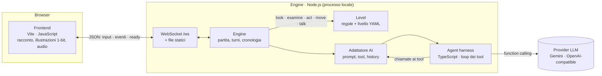
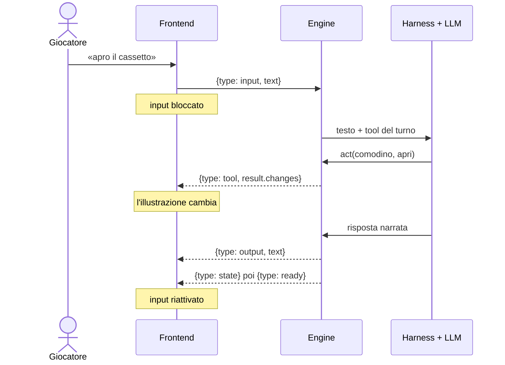

# BadNight · Architettura

BadNight è un'avventura testuale horror per bambini: il giocatore scrive in linguaggio naturale cosa fa il
bambino, un agente AI lo traduce in azioni di gioco e racconta cosa succede. **Le regole e lo stato della
partita sono in un engine deterministico**: il modello può agire sul mondo solo attraverso i tool che l'engine
gli espone, quindi non può inventare progressi né rivelare più di quanto previsto.

## Componenti



| Componente | Cartella | Responsabilità |
| --- | --- | --- |
| **Frontend** | `frontend/` | Pagina di gioco: invia il testo del giocatore, mostra racconto (effetto macchina da scrivere), stanza, uscite, traguardi, un'illustrazione 1-bit per l'elemento in scena, musica ed effetti. |
| **Engine** | `packages/engine/` | Server CLI: un'unica partita in memoria, i turni, la cronologia, il WebSocket, la pagina servita, i log. Collega l'agente AI ai tool di gioco. |
| **Level** | `packages/level/` | Caricamento e validazione del livello YAML, stato della partita, regole, i 5 tool di gioco. Nessuna dipendenza da AI o rete. |
| **Agent harness** | `packages/agent-harness/` | Loop del modello: dichiara i tool, ne valida gli argomenti, li esegue, ripete finché il modello risponde; regole di sicurezza per bambini; adattatore OpenAI-compatible. |

## Un turno di gioco



- Un turno alla volta: il frontend resta bloccato fino a `ready`, che arriva sempre (anche dopo un errore
  o il timeout di 120 s).
- Il modello usa pochi tool per messaggio: se la richiesta è chiara agisce subito, se è vaga si ferma e dà
  un suggerimento (cosa c'è intorno, da dove cominciare) invece di esplorare al posto del bambino.
- Dopo il timeout i tool del turno rifiutano le chiamate: un modello in ritardo non può cambiare lo stato.

## Il gioco come dati

Il livello è un file YAML (`packages/level/levels/level-1.yaml`), validato all'avvio:

- **Stanze** con oggetti, fantasmi e uscite. Il livello 1 ha 3 stanze (cameretta → salone → camera dei
  genitori), 18 oggetti, 6 fantasmi e 4 enigmi ([Enigmi.md](Enigmi.md)).
- **Azioni ed esiti**: ogni oggetto o fantasma ha azioni; ogni azione ha esiti ordinati con condizioni
  (`completed`, `state`, `visited`, `not/all/any`) ed effetti (`set_state`, `reveal`, `hide`, `complete`).
- **Traguardi in un DAG**: un traguardo si completa solo dopo i suoi prerequisiti; le uscite si sbloccano
  con i traguardi. I cicli sono rifiutati al caricamento.
- **Niente inventario**: gli oggetti restano nella loro stanza; gli oggetti da trovare sono nascosti e
  compaiono con `reveal`.
- **Fantasmi**: personalità e informazioni (`knowledge`) sbloccate dai traguardi. Il tool `talk` passa al
  modello solo le informazioni già sbloccate.
- **Asset**: ogni elemento ha un id grafico che il frontend associa a un disegno; al modello non arriva.

## Protocollo frontend ↔ engine

Un solo WebSocket, messaggi JSON con campo `type`, nessuna autenticazione (prototipo locale, un giocatore).

| Direzione | Messaggi |
| --- | --- |
| frontend → engine | `input` (testo libero), `reset` (nuova partita) |
| engine → frontend | `state` (stato completo + cronologia), `input`, `tool` (con le variazioni), `output` (testo per il giocatore), `error`, `ready` |

Alla connessione l'engine invia `state` e `ready`: dopo un ricaricamento la pagina ricostruisce il racconto
dalla cronologia. Dettagli: [packages/engine/README.md](packages/engine/README.md#websocket-ws).

## Provider AI

| Provider | Configurazione | Note |
| --- | --- | --- |
| Gemini AI Studio (default) | `GEMINI_API_KEY` | Gemma 4 31B per tool e ragionamento, Gemma 4 26B per la narrazione |
| OpenAI-compatible | `AGENT_PROVIDER=openai-compatible`, `NVIDIA_BASE_URL`, `NVIDIA_API_KEY`, `NVIDIA_MODEL` | NVIDIA NIM o qualsiasi endpoint Chat Completions (es. OpenAI `gpt-6-luna` con `NVIDIA_REASONING_EFFORT=none`) |

Senza chiavi l'engine usa un agente di sviluppo a comandi testuali (`act letto guarda_sotto`), utile per
provare engine e frontend senza modello.

## Sicurezza e osservabilità

- Le chiavi restano nel processo server (`.env`, ignorato da git); il server ascolta solo su `127.0.0.1`.
- Input del browser validato (JSON, tipo, testo non vuoto, max 64 KiB); gli argomenti dei tool sono validati
  con JSON Schema prima dell'esecuzione.
- Contenuti adatti a un bambino di sei anni: istruzioni di sicurezza fisse nel harness, più il prompt
  dell'engine (italiano, niente soluzioni regalate, fantasmi che non rivelano più del dovuto).
- Console: una riga per turno (durata, tool usati, errore riassunto). `logs/llm-calls.log`: richieste e
  risposte complete al provider, svuotato a ogni avvio, senza intestazioni né chiavi.
- Baseline di sicurezza del prototipo: [docs/MVSP.md](docs/MVSP.md).

## Stack e avvio

Node.js 22 · pnpm workspace (engine, level, harness) · TypeScript (harness) · Vite (frontend) · `ws` ·
Google GenAI SDK · test con `node:test`.

```sh
corepack pnpm install
cp .env.example .env      # chiave del provider AI
corepack pnpm start       # compila il frontend e avvia l'engine → http://127.0.0.1:3000
corepack pnpm test        # test di level, engine e harness
```
